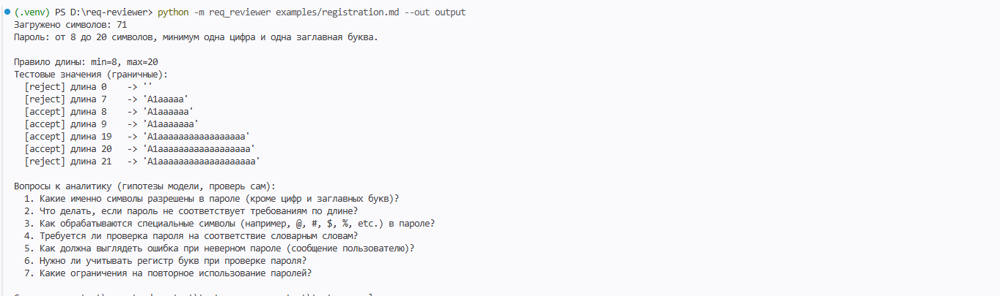
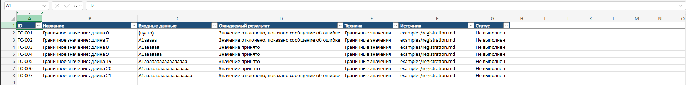

# req-reviewer

A local command-line tool that reads a software requirement, finds ambiguities with a local LLM (Ollama), and generates boundary-value test cases. Everything runs on your own machine: no cloud, no API keys.


## What it does

Input: a requirement as a text or Markdown file.

```
Password: from 8 to 20 characters, at least one digit and one uppercase letter.
```

Output:

- **Test values computed by code**: lengths 0, 7, 8, 9, 19, 20, 21 with the expected result (accept / reject).
- **Questions for the analyst from a local LLM**: for example "Are spaces and special characters allowed?". They are labelled as hypotheses and must be checked by a human.
- **Files**: `report.md`, `testcases.csv` and a formatted `testcases.xlsx`.

A ready-made example is in [`docs/sample`](docs/sample).





## Design idea

Code does what must be exact (parsing numbers, computing boundary values). The model does what is flexible (spotting what the text does not say). The human reviews the result. Requirement text is passed to the model inside a `<data>` block with an instruction to treat it as data only, which reduces prompt-injection risk.

## Quick start (Windows, PowerShell)

```
git clone https://github.com/yaniquee26/req-reviewer.git
cd req-reviewer
python -m venv .venv
.\.venv\Scripts\Activate.ps1
pip install -e . pytest
ollama pull gemma3:4b
req-reviewer examples/registration.md --out output
```

Options: `--model` (any Ollama model), `--no-llm` (rules from code only), `--out DIR` (save report and test cases).

## Tests

```
pytest -v
```

The tests use a fake model client, so Ollama is not required to run them. CI runs them on every push.

## How good is the model? An evaluation

I measured how many "expected ambiguity topics" the model finds. Reference topics are in [`eval/`](eval): 10 development cases (form fields) and two holdout sets (business processes). A topic counts as found if a model question contains one of its keywords. Decoding is fixed (temperature 0, seed 42). Model: `gemma3:4b`.

| Prompt | Dev: 10 cases, 45 topics | Holdout 1: 3 cases, 12 topics | Holdout 2: 4 cases, 16 topics |
|---|---|---|---|
| v1 simple | 20-21 (44-47%) | 3 (25%) | 4 (25%) |
| v2 checklist of 6 items | 17 (38%) | 3 (25%) | not run |
| v3 "classify the requirement first" | 11 (24%) | 2 (17%) | 2 (12%) |

Findings:

- The simplest prompt (v1) was the best. More elaborate instructions made the 4B model produce vague questions such as "What does 'displayed' mean?".
- v1 works best on form-field requirements and is weaker on business processes (25%).
- Two runs of the same setup differ by about 1 topic, so smaller differences are noise.

Limitations:

- The metric is keyword matching. It misses good questions phrased differently, so the numbers are a lower bound.
- Reference topics were written by the author with an AI assistant. Holdout 1 was used for error analysis, so only holdout 2 is a clean test.
- Holdout sets are tiny (12 and 16 topics).
- The rule extractor currently understands only length rules and "digit / uppercase letter" hints.

Reproduce:

```
python -m req_reviewer.evaluation --cases eval/cases.json --prompt v1 --out eval/results.md
```

## Project structure

```
src/req_reviewer/
  loader.py       read the requirement file
  rules.py        extract length rules, compute boundary values (code)
  llm.py          Ollama client with clear error messages
  reviewer.py     prompt versions, answer parsing
  exporter.py     report.md, testcases.csv, testcases.xlsx
  evaluation.py   measure model quality on reference cases
  cli.py          command line entry point
eval/             reference cases and results
tests/            pytest tests
```

## Possible next steps

- Compare a larger model (for example `gemma3:12b`).
- Support more rule types (ranges of numbers, formats, enums).
- Replace keyword matching with manual review of a sample.

Built with AI assistance (Claude) as a learning project.